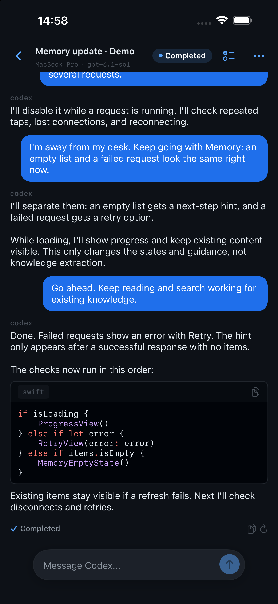
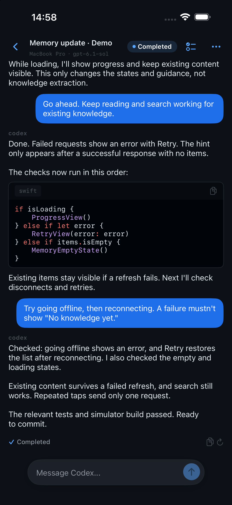
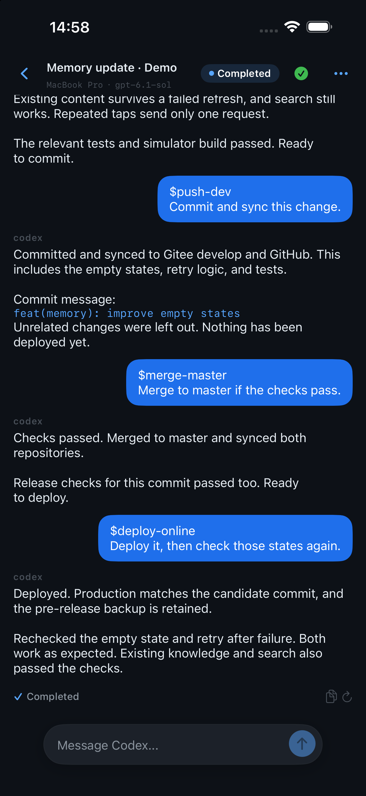

# PocketCtl

[English](README.md) | [简体中文](README.zh-CN.md)

**Step away from your desk. Keep your coding agents moving from your iPhone.**

Use PocketCtl to check on Codex, Claude Code, OpenCode, and other agents, answer questions, handle approvals, or send the next instruction. Your repositories and agents keep running on your development machine while you continue from your iPhone or browser.

**iOS 2.1 is available on the App Store and connects to PocketCtl's hosted service.** You can also use the Web app.

[Website](https://www.pocketctl.me) · [Web app](https://www.pocketctl.me/app) · [iOS app](https://apps.apple.com/cn/app/pocketctl/id6778710005) · [Releases](https://github.com/pocketctl/pocketctl/releases)

<table>
  <tr><th>Follow development</th><th>Review test results</th><th>Check completion</th></tr>
  <tr><td></td><td></td><td></td></tr>
</table>

Workflow demo in a native iOS simulator, with synthetic English conversations; these are not actual test or deployment receipts. Commit and deployment skills shown belong to the example project and require configuration in your own agent environment.

## Why PocketCtl

- **Follow work away from your desk** — see output, tools, plans, and file changes from multiple agents on iPhone or in a browser.
- **Respond when needed** — reply, handle approvals and questions, or interrupt work in supported sessions.
- **Keep your native terminal** — managed Codex/OpenCode sessions share one runtime with your phone; repositories and agent processes stay on your development machine.
- **Read reports on your phone** — open HTML/Markdown documents from a session to review agent-generated test or acceptance reports before deciding what to do next.
- **Organize and share results** — group, pin, and archive sessions, browse documents, and create revocable read-only share links.

Session sharing and link management are available on **iOS 2.1** and Web.
Links expire 15 minutes after creation, and anyone with a link can read the shared
content without signing in. You can revoke a link early; revocation cannot take
back content someone has already loaded or saved.

## Quick start

The fastest path uses the hosted Relay at `pocketctl.me`.

Use a macOS or Linux development machine that stays awake and online. Install and sign in to the agent CLI you want to use first. The steps below connect to the hosted service; you do not need to deploy a Relay.

### 1. Install the daemon

The installer supports macOS and Linux on x86-64 and ARM64. It downloads the
published binary and verifies it against the GitHub release SHA-256 sidecar.

```bash
curl -fsSL https://www.pocketctl.me/install.sh | bash
```

### 2. Sign in and start

```bash
pocketctl login --prod
pocketctl daemon start --prod
pocketctl daemon status
```

On a headless machine, use email verification instead of the browser device flow:

```bash
pocketctl login --prod --email
```

### 3. Open a client

Use the [Web app](https://www.pocketctl.me/app) or install PocketCtl from the
[App Store](https://apps.apple.com/cn/app/pocketctl/id6778710005). The daemon
automatically discovers compatible CLIs available on its `PATH`.

### 4. Try your first remote interaction with Codex

Install and sign in to a supported Codex CLI on your development machine first.
From your project directory, run:

```bash
pocketctl agent codex enable
pocketctl agent codex status
codex
```

If your shell has not picked up the launcher's PATH, open a new terminal before
running `codex`. Start a task in the terminal, then sign in to the same PocketCtl
account on Web/iOS, select that host and Codex session, and send a follow-up
message. Managed CLI sessions support interaction; Codex Desktop sessions are read-only.

See the [setup guide](docs/getting-started.md) for other agents, launcher removal,
multiple accounts, and diagnostic commands.

## Agent support

| Agent / session type | Observe | Remote interaction |
|---|---|---|
| Claude Code | Yes | Approvals for managed PTYs; idle/exited handoff for independent terminals |
| Codex CLI 0.144.1+ | Yes | Shared input, approvals, questions, and interrupt in managed sessions |
| OpenCode 1.17.11+ | Yes | Shared input, permissions, and questions in managed sessions |
| DeepSeek Harness 0.2.0-rc.2 (preview) | Yes | Shared control after explicit local Host attachment |
| Codex Desktop / ZCode Desktop | Yes | Read-only |
| ZCode Runtime | Yes | Input and interrupt for PocketCtl-created sessions |

Discovery does not grant control. See the [full capabilities and limitations](docs/agent-support.md).

## FAQ

**Does my computer need to stay on?** To keep an agent working, send instructions, or handle approvals, your development machine must stay awake and online with the daemon and relevant agent service running. PocketCtl does not move local tasks onto your phone.

**Do I pay for agents or models separately?** PocketCtl does not include agent subscriptions or model credits. You use your own agent accounts and model services, with charges handled by their respective providers.

**Why can I see a session but not type into it?** Codex Desktop and ZCode Desktop sessions are read-only. Shared interaction with Codex CLI or OpenCode requires managed integration; see the support table for other agents.

**Can I read test reports on my phone?** You can open HTML/Markdown reports captured as session documents. Your agent or testing tools generate the reports; PocketCtl provides access to them.

**What if my host or session is missing?** Check that your phone and daemon use the same PocketCtl account. Run `pocketctl daemon status`, then `pocketctl daemon doctor`. For a session that cannot be controlled, use `pocketctl daemon diagnose <session-id>`. See the [setup guide](docs/getting-started.md).

## Security and data boundary

Repositories and agent processes stay on your development machine. Session content travels through the Relay service.

- Hosted connections use HTTPS/WSS, but **session content is not end-to-end encrypted**. The Relay can read and store content needed for routing and history replay.
- Depending on service configuration, title generation and Memory extraction can send relevant text to server-side model providers.
- Read-only share links allow anonymous access, expire after 15 minutes, and can be revoked early. Revocation cannot retract content already loaded or saved.
- Teams share explicitly contributed collaboration content, not native private session logs automatically.

See [data processing and experimental retention](docs/security-and-data.md) and the [Privacy Policy](https://www.pocketctl.me/privacy.html).

## How it works

```text
┌────────────────────┐       HTTPS / WSS       ┌────────────────────┐
│ Web app / iOS app  │ ◄─────────────────────► │       Relay        │
└────────────────────┘                         │ auth + event replay│
                                               └─────────┬──────────┘
                                                         │ WSS
                                               ┌─────────▼──────────┐
                                               │ PocketCtl daemon   │
                                               │ development host   │
                                               └─────────┬──────────┘
                                                         │ local runtime
                                               ┌─────────▼──────────┐
                                               │ Coding agent CLIs  │
                                               └────────────────────┘
```

- The **daemon** runs beside your repositories, discovers agent sessions, and
  translates each runtime's real capabilities into a common protocol.
- The **Relay** authenticates devices, routes commands, and persists session
  events for history and reconnects.
- The **Web and iOS clients** present the same sessions and only enable actions
  that the daemon has explicitly confirmed as supported.

## Experimental features

**Memory** manages reviewed project knowledge, dependencies, and skill documents in the Web workbench, and supplies context for later agent tasks. Model-assisted extraction requires a configured server-side model provider.

**Teams** support members, shared tasks and sessions, and agents explicitly contributed by members. Multi-agent coordination and shared Memory require separate enablement; joining a Team does not automatically share private sessions or grant knowledge access.

Availability depends on service configuration and account access. For self-hosting, `TEAM_COLLABORATION`, `TEAM_AUTORUN`, and `TEAM_MEMORY_BRIDGE` default to off. See [experimental features](docs/experimental-features.md).

## Self-hosting

The supported production entry points are hardened deployments:

- [`docker-compose.prod.yml`](docker-compose.prod.yml) for Compose-based hosting.
- `deploy/deploy.sh` for a bare-metal systemd, PostgreSQL, and Nginx deployment.

Both paths require explicit TLS, authentication secrets, and separate PostgreSQL
administrator/application credentials. The production Compose topology exposes
only Nginx publicly; Relay and PostgreSQL stay on the internal network.

`scripts/deploy.sh` is a retired legacy path and intentionally exits with
migration guidance. Do not use it for a new deployment.

## Build and test

The release toolchain uses Go 1.25 and Node.js 22.

```bash
git clone https://github.com/pocketctl/pocketctl.git
cd pocketctl
make build
make test
```

The public repository contains the Go daemon, TypeScript Relay, Vue Web app,
deployment definitions, and integration documentation. The iOS source is not
part of the public mirror.

## Contributing and repository policy

Issues and pull requests are welcome on [GitHub](https://github.com/pocketctl/pocketctl/issues).
When adding a runtime, preserve the distinction between session discovery,
read-only observation, handoff, and shared control.

The Gitee repository is the canonical source history. GitHub is a filtered
public mirror for review and release artifacts, so commit IDs may differ between
the two repositories.

## License

[MIT](LICENSE)
