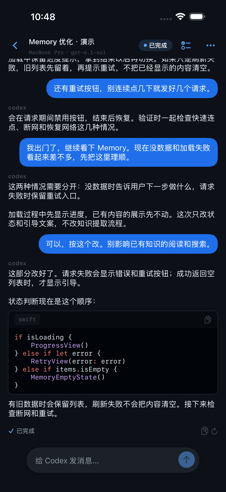
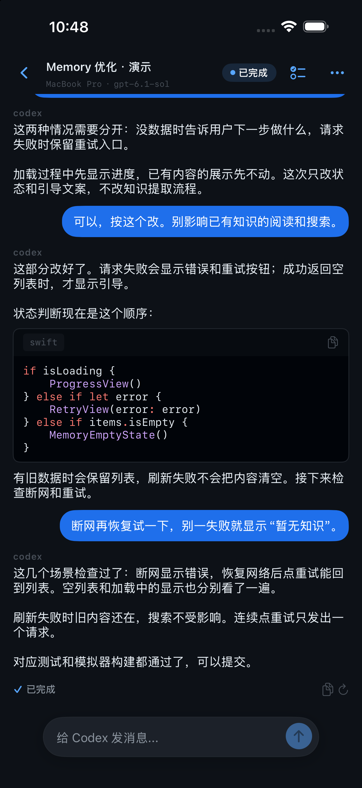
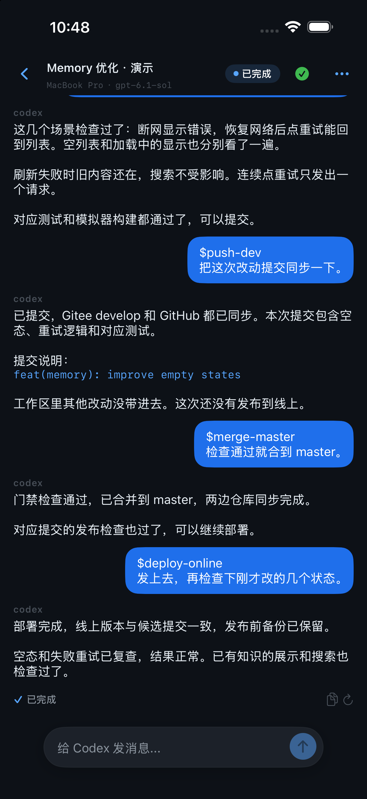

# PocketCtl

[English](README.md) | [简体中文](README.zh-CN.md)

**离开电脑，也能用 iPhone 继续推进 AI 编码任务。**

用 PocketCtl 查看 Codex、Claude Code、OpenCode 等 Agent 的进度，回答问题、处理审批，或继续发送任务。代码仓库和 Agent 仍在你的开发机上运行，你通过 iPhone 或浏览器接着操作。

**iOS 2.1 已在 App Store 上架，可连接 PocketCtl 线上服务。** 也可直接使用 Web 客户端。

[官网](https://www.pocketctl.me) · [Web 客户端](https://www.pocketctl.me/app) · [iOS App](https://apps.apple.com/cn/app/pocketctl/id6778710005) · [版本发布](https://github.com/pocketctl/pocketctl/releases)

<table>
  <tr><th>跟进开发</th><th>检查测试结果</th><th>确认任务完成</th></tr>
  <tr><td></td><td></td><td></td></tr>
</table>

原生 iOS 模拟器中的流程演示，使用中文合成会话；不是实际测试或上线回执。图中的提交与部署 Skill 来自示例项目，使用时需在自己的 Agent 环境中配置。

## 为什么使用 PocketCtl

- **离开电脑也能跟进** — 在 iPhone 或浏览器查看多个 Agent 的输出、工具调用、计划与文件改动。
- **需要你时直接响应** — 在支持的会话中回复消息、处理审批和问题，或中断当前任务。
- **继续使用原生终端** — 受管 Codex/OpenCode 与手机共享同一运行时，代码和 Agent 进程留在开发机。
- **在手机上查看报告** — 从会话中打开 HTML/Markdown 文档，查看 Agent 生成的测试或验收报告，再决定下一步。
- **整理工作与分享结果** — 按项目组织、置顶和归档会话，查看文档，并生成可撤销的只读分享链接。

会话分享与链接管理已包含在 **iOS 2.1**，Web 端同样支持。分享链接固定有效期为
15 分钟，持有链接者无需登录即可读取分享内容；你可以在到期前主动撤销。
撤销不会收回对方已经加载或保存的内容。

## 快速开始

最快的使用方式是连接 `pocketctl.me` 提供的托管 Relay。

准备一台保持开机、联网的 macOS 或 Linux 开发机，并先安装、登录要使用的 Agent CLI。以下步骤连接线上服务，无需自行部署 Relay。

### 1. 安装 Daemon

安装脚本支持 macOS 和 Linux 的 x86-64、ARM64 架构，会下载已发布的二进制，
并使用 GitHub Release 的 SHA-256 校验文件验证完整性。

```bash
curl -fsSL https://www.pocketctl.me/install.sh | bash
```

### 2. 登录并启动

```bash
pocketctl login --prod
pocketctl daemon start --prod
pocketctl daemon status
```

无浏览器的服务器可以改用邮箱验证码：

```bash
pocketctl login --prod --email
```

### 3. 打开客户端

使用 [Web 客户端](https://www.pocketctl.me/app)，或从
[App Store](https://apps.apple.com/cn/app/pocketctl/id6778710005) 安装 PocketCtl。
Daemon 会自动发现 `PATH` 中兼容的 Agent CLI。

### 4. 完成第一次远程交互（以 Codex 为例）

开发机需先安装并登录受支持的 Codex CLI。在项目目录执行：

```bash
pocketctl agent codex enable
pocketctl agent codex status
codex
```

若当前终端尚未加载 Launcher 的 PATH，打开新终端后再运行 `codex`。
先在终端发起一个任务，然后在同一 PocketCtl 账号的 Web/iOS 客户端中选择该主机和
Codex 会话，查看输出并发送后续消息。受管 CLI 会话支持交互；Codex Desktop 会话只读。

其他 Agent、停用 Launcher、多账号和诊断命令见[接入指南](docs/getting-started.zh-CN.md)。

## Agent 支持范围

| Agent / 会话类型 | 查看 | 远程交互 |
|---|---|---|
| Claude Code | 支持 | 受管 PTY 支持审批；独立终端需空闲/退出后接力 |
| Codex CLI 0.144.1+ | 支持 | 受管会话支持共享输入、审批、问题和中断 |
| OpenCode 1.17.11+ | 支持 | 受管会话支持共享输入、权限确认和问题 |
| DeepSeek Harness 0.2.0-rc.2（预览） | 支持 | 显式接入本地 Host 后支持共享控制 |
| Codex Desktop / ZCode Desktop | 支持 | 只读 |
| ZCode Runtime | 支持 | PocketCtl 创建的会话支持输入和中断 |

发现会话不等于获得控制权。详见[完整能力与限制](docs/agent-support.zh-CN.md)。

## 常见问题

**手机操作时，电脑必须开着吗？** 继续运行 Agent、发送指令或处理审批时，开发机需要保持唤醒、联网，且 Daemon 与相应 Agent 服务正常运行。PocketCtl 不会把本地任务转移到手机执行。

**需要另付 Agent 或模型费用吗？** PocketCtl 不包含 Agent 订阅或模型额度。继续使用你自己的 Agent 账号与模型服务，其费用由相应供应商收取。

**为什么能看到会话，却不能输入？** Codex Desktop 和 ZCode Desktop 会话只读。Codex CLI、OpenCode 的共享交互需要受管接入；其他 Agent 的条件见上方支持表。

**手机可以查看测试报告吗？** 可以从会话打开已捕获为会话文档的 HTML/Markdown 报告。报告由你的 Agent 或测试工具生成，PocketCtl 提供查看入口。

**主机或会话没有出现怎么办？** 确认手机和 Daemon 登录同一个 PocketCtl 账号，检查 `pocketctl daemon status`，再运行 `pocketctl daemon doctor`。单个会话无法交互时可用 `pocketctl daemon diagnose <会话ID>` 排查，详见[接入指南](docs/getting-started.zh-CN.md)。

## 安全与数据边界

代码仓库和 Agent 进程留在开发机，会话内容通过 Relay 服务传输。

- 线上连接使用 HTTPS/WSS，但**会话内容不是端到端加密**；Relay 可读取并保存路由与历史重放所需的内容。
- 按服务配置，标题生成和 Memory 提炼可能将相关文本发送给服务端模型供应商。
- 只读分享链接允许匿名访问，15 分钟后过期，也可提前撤销；撤销不能收回他人已加载或保存的内容。
- Team 只共享明确提供的协作内容，不会自动共享原生私人会话日志。

详见[数据处理与实验性保留策略](docs/security-and-data.zh-CN.md)及[隐私政策](https://www.pocketctl.me/privacy.html)。

## 工作原理

```text
┌────────────────────┐       HTTPS / WSS       ┌────────────────────┐
│ Web 客户端 / iOS   │ ◄─────────────────────► │       Relay        │
└────────────────────┘                         │ 认证 + 事件重放     │
                                               └─────────┬──────────┘
                                                         │ WSS
                                               ┌─────────▼──────────┐
                                               │ PocketCtl Daemon   │
                                               │      开发机         │
                                               └─────────┬──────────┘
                                                         │ 本地 Runtime
                                               ┌─────────▼──────────┐
                                               │  AI 编码 Agent CLI │
                                               └────────────────────┘
```

- **Daemon** 与代码仓库运行在同一台开发机上，发现 Agent 会话，并把不同
  Runtime 的真实能力转换为统一协议。
- **Relay** 负责设备认证、命令路由，以及会话事件的持久化、历史重放和重连。
- **Web 与 iOS 客户端** 展示同一批会话，只开放 Daemon 明确确认支持的操作。

## 实验性功能

**Memory** 在 Web 工作台中管理经过评审的项目知识、依赖关系和 Skill 文档，并为后续 Agent 任务提供上下文。模型辅助提炼需要配置服务端模型 Provider。

**Team** 支持成员、共享任务与会话，以及调用成员明确提供的 Agent。多 Agent 协作和共享 Memory 需要分别启用；加入 Team 不会自动共享私人会话或授予知识访问权限。

这些能力取决于服务配置与账号权限。自托管的 `TEAM_COLLABORATION`、`TEAM_AUTORUN`、`TEAM_MEMORY_BRIDGE` 默认关闭。详见[实验性功能说明](docs/experimental-features.zh-CN.md)。

## 自托管

支持的生产部署入口只有经过加固的两种路径：

- [`docker-compose.prod.yml`](docker-compose.prod.yml)：基于 Compose 部署。
- `deploy/deploy.sh`：基于 systemd、PostgreSQL 和 Nginx 的裸机部署。

两种路径都要求显式配置 TLS、认证密钥，以及相互独立的 PostgreSQL 管理员和
应用账户凭据。生产 Compose 拓扑只公开 Nginx；Relay 和 PostgreSQL 保留在
内部网络中。

`scripts/deploy.sh` 是已退役的旧部署入口，会主动退出并给出迁移说明；不要用于
新的生产部署。

## 构建与测试

发布工具链使用 Go 1.25 和 Node.js 22。

```bash
git clone https://github.com/pocketctl/pocketctl.git
cd pocketctl
make build
make test
```

公共仓库包含 Go Daemon、TypeScript Relay、Vue Web 客户端、部署定义和集成文档。
iOS 源码不属于 GitHub 公共镜像。

## 参与贡献与仓库说明

欢迎在 [GitHub](https://github.com/pocketctl/pocketctl/issues) 提交 Issue 和 Pull Request。
扩展新 Runtime 时，请保留“发现会话、只读观察、接力恢复、共享控制”之间的边界。

Gitee 仓库保存规范源码历史；GitHub 是用于公开审阅和 Release 资产的过滤镜像，
两边的 Commit ID 可能不同。

## License

[MIT](LICENSE)
